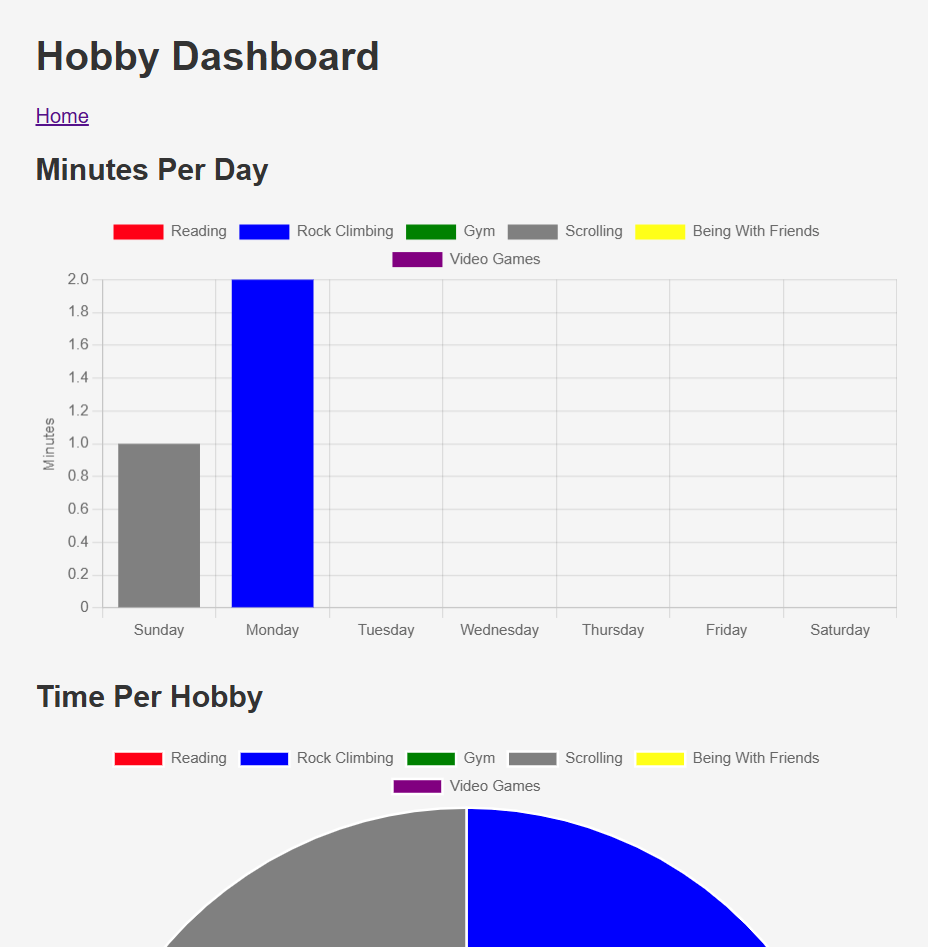
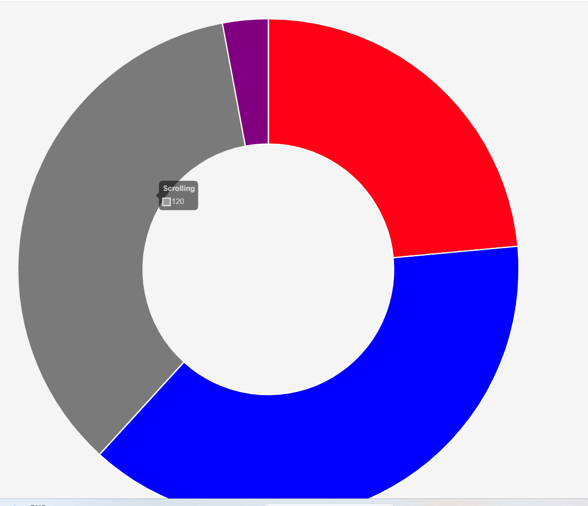
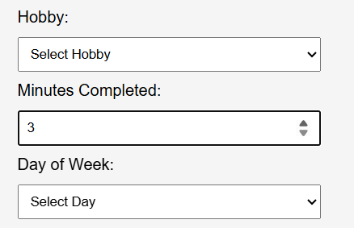
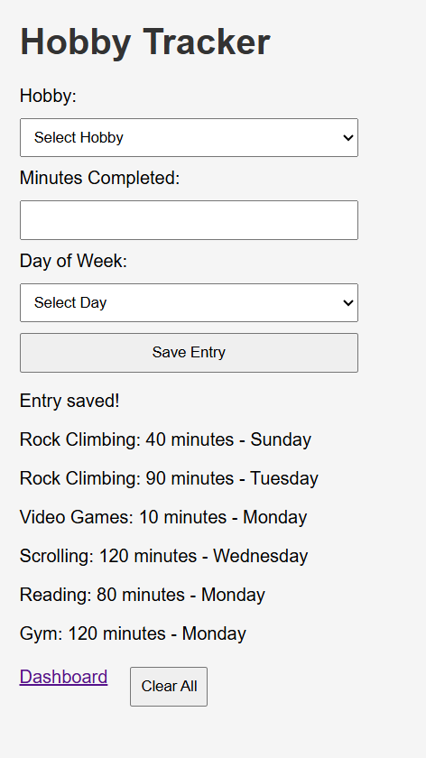
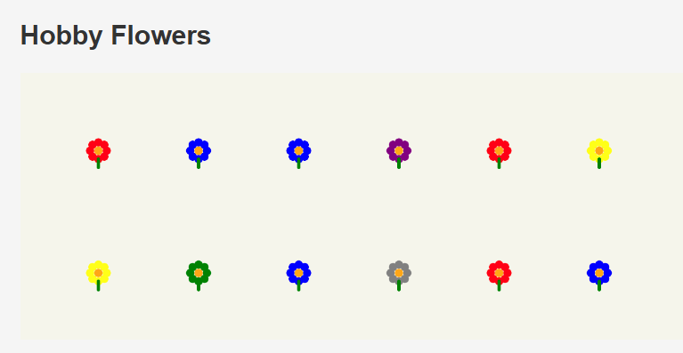
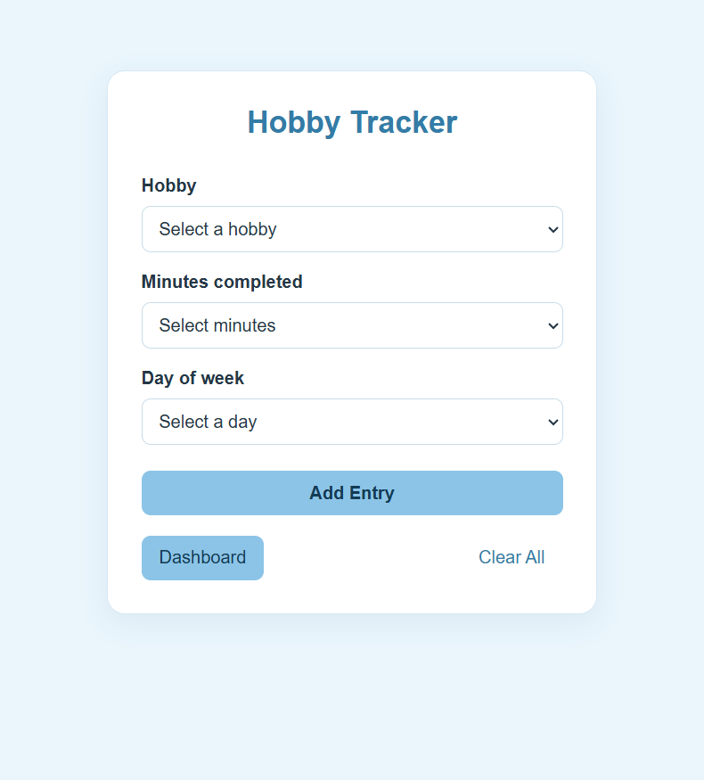
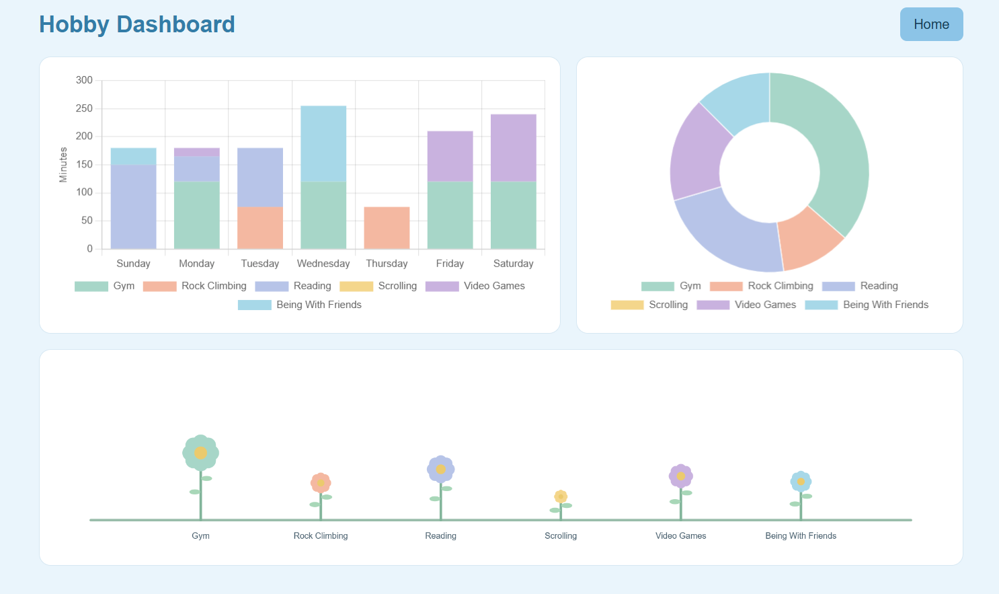
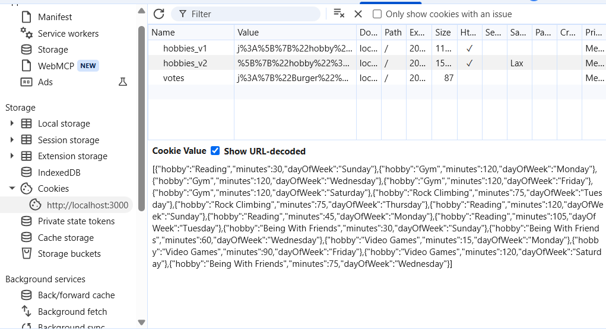
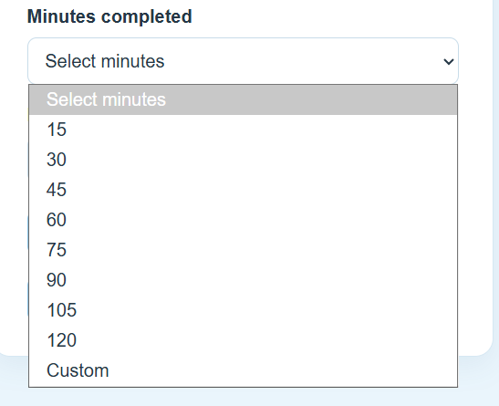

# Cookie Tracker – Hobby Time

🎥 **Video walkthrough:** [Project demo](https://drive.google.com/file/d/1VKCyFOlXxsnCv7hRJsBmImMqagCPAb0v/view?usp=sharing)


## What I tracked and why
I decided to track how long I spend on my hobbies each day. I thought it would be fun to track to see visually how much time I am spending doing the various things I enjoy to do. I was also hoping it would inspire me to reduce some of my bad habits like just sitting and scrolling or playing video games and instead go be with friends or read. 

## Version 1 (prompt v1)
[Prompt v1](tracker-docs/prompt-v1.md)



### What worked 
Before giving me any files, the agent told me what the layout of my directory would be, which was very helpful.

The agent added `const path = require("path");` and `app.use(express.json());` to the App.js, and suggested additional middleware statements, but they were already present. 

My orginal prompt included references to Handlebars.js, and I specifically told it to include a response.hbs and a survey.hbs. Instead of blindly doing as I asked, the agent explained to me how included these were not necessary, and how it would be simplier to just use Javascript and .html files instead.

The application is very responsive. The graphs grow and shrink as I change the size of my screen. 

Very good error handling. I am not able to input a negative number for time, I am not able to type letters for time, and I cannot leave any of the three inputs blank. 

### What Didn't 
I didn't specify any specific colors for my application beyond those to be used in the graph. Additionally, I gave specfic instructions to keep the UI simple. As a result, the application looks very sad and grey. Also, the colors that I suggested using for the graph don't work well together and are too bright, so the graphs themselves also don't look good. 

The graphs are too big to fit on the screen, especially in full screen mode. It is necessary to shrink the screen to half the size in order to be able to see a graph in full.

Hobby is a dropdown menu and day of week is a dropdown menu, but time isn't. You can increment it by one by clicking up or down on the errors to the right, or you can type in a number. It would be better if you could select a time from a list of common times, and type one in yourself if it does not appear. It would also be a better user experience if all three were cohesive and used the same dropdown style selection.  

As the user logs their activities, they clutter the bottom of the page. This makes it look very messy and there's no real purpose for them to be there. 

I also didn't like having different flowers for the same hobby that get planted based on the frequency of the activity. I think it would be better just to have 6 flowers that continually grow as more time is spent doing that activity. It also doesn't look like it's apart of the real dashboard. It should look more cohesive. 

#### Graph That is Too Large


#### Inconsistent Form Inputs 


#### Entries Cluttering Bottom


#### Garden


...

## Version 2 – Final (prompt v2)
[Prompt v2](tracker-docs/prompt-v2.md)







### Biggest change from v1 to v2, and why it helped:
The biggest change was specified exactly what I wanted from the UI. That was something I had largely neglected in the first script. My only real mention of UI was telling the application to keep it simple, because often AI applications can add a lot of junk to the UI. I also never defined what kinda of color or color theme I wanted the application to have. This resulted in a sad grey-scale application, with an off-centered input form, graphs that didn't fit on the screen, and inconsistent inputs. In my v2 script, I was very specific about what I wanted UI-wise. I said I wanted an overall blue color theme, I wanted to graphs to be in pastel, and I defined the layout of the dashboard. I also was specific about how I wanted the form to look, and included that the "Minutes Completed" section should have a dropdown to select common times. Overall, this led to a more aesthetically pleasing website, and a better user expereince as it was quicker to log hobbies completed. Being specific was so helpful because it told the AI agent exactly how I wanted my application to look and feel. It gave it more to build off of, so it was able to create a better expereince. 


#### Minute Input Dropdown 




### Hand edits I made (if any):
I edited the third parameter of `res.cookie()`. Originally, the AI agent had generated this:

```js
    res.cookie("hobbies_v2", JSON.stringify(hobbies), {
        maxAge: 7 * 24 * 60 * 60 * 1000,
        httpOnly: true,
        sameSite: "lax"
    });
```

However, setting `httpOnly: true` and `sameSite: lax` felt unncessary to me, as I wanted to keep the program as straightforward as possible. So, I simplified it to just:

```js
    res.cookie("hobbies_v2", JSON.stringify(hobbies), {
        maxAge: 7 * 24 * 60 * 60 * 1000,
    });
```

I also had to manually add the title to the charts in version 2, as it did not automatically name the charts as it did in version 1. 

```js
plugins: {
title: { display: true, text: "Minutes Per Day" },
legend: { position: "bottom" }
},
```

## How my code works (in my own words)

### Saving the cookie

#### Save Route
```js
app.post("/tracker/v2/form", (req, res) => {
    const hobby = req.body.hobby;
    const minutes = Number(req.body.minutes);
    const dayOfWeek = req.body.dayOfWeek;

    const validHobbies = [
        "Gym",
        "Rock Climbing",
        "Reading",
        "Scrolling",
        "Video Games",
        "Being With Friends"
    ];

    const validDays = [
        "Sunday", "Monday", "Tuesday", "Wednesday",
        "Thursday", "Friday", "Saturday"
    ];

    if (
        !validHobbies.includes(hobby) ||
        !validDays.includes(dayOfWeek) ||
        !Number.isInteger(minutes) ||
        minutes <= 0
    ) {
        return res.status(400).send("Invalid entry");
    }

    let hobbies = [];

    if (req.cookies.hobbies_v2) {
        hobbies = JSON.parse(req.cookies.hobbies_v2);
    }

    const newEntry = {
        hobby: hobby,
        minutes: minutes,
        dayOfWeek: dayOfWeek
    };

    hobbies.push(newEntry);

    res.cookie("hobbies_v2", JSON.stringify(hobbies), {
        maxAge: 7 * 24 * 60 * 60 * 1000
    });

    // Return to the form without displaying the submitted data.
    res.redirect("/tracker/v2/home");
});

```
Creates a POST request. 

First, this function extracts the three from inputs (hobby, minutes, and dayOfWeek) from `req.body`.

Then, it constructs the list of validHobbies and the list of validDays to choose from. 

Then, it peforms error checking. It uses the arrays to ensure that the user selected a valid hobby and a valid day of week. It also ensures that the number entered is a positive integer.

Next, the function creates an empty array to hold the cookie: ` let hobbies = [];`. If there is an existing cookie with the request, it sets hobby equal to that cookie: `hobbies = JSON.parse(req.cookies.hobbies_v2);`. 

Then, it creates a new entry to be added to the cookie array. It is built using the form data extracted in the first three lines. Once the entry is created, it is pushed to the hobby array. 

The next line, `res.cookie`, is responsible for saving the updated array in a browser cookie. There are three parameters: the name of the cookie, a JSON string of the array (converted using `JSON.stringify`), and an object that sets the maxAge of the cookie to be one week. 

The final line redicts the form back to the page it was just on using `res.redirect`. This is necessary so the user can submit form data, and remain on the form submission page. 


### Getting the data to the dashboard

#### Data Route
```js 
app.get("/tracker/v2/data", (req, res) => {
    const hobbies = req.cookies.hobbies_v2
        ? JSON.parse(req.cookies.hobbies_v2)
        : [];

    res.json(hobbies);
});
```
Creates a GET request.

This function gets the `hobbies_v2` cookie from the `req`, and saves it in the variable `hobbies`. 

If the cookie exists, it gets converted to an array using `JSON.parse()`. If it does not exist, `hobbies` gets set to an empty array. 

Then, `res.json(hobbies)` sends the array to the browser in JSON format. 

#### fetch()
```js
async function loadDashboard() {
  const response = await fetch("/tracker/v2/data");

  if (!response.ok) {
    throw new Error("Could not load hobby data.");
  }

  const entries = await response.json();
  const dailyTotals = Object.fromEntries(
    days.map(day => [day, Object.fromEntries(hobbies.map(hobby => [hobby, 0]))])
  );

  hobbyTotals = Object.fromEntries(hobbies.map(hobby => [hobby, 0]));

  entries.forEach(entry => {
    if (!hobbies.includes(entry.hobby) || !days.includes(entry.dayOfWeek)) return;

    const minutes = Number(entry.minutes);
    if (!Number.isFinite(minutes) || minutes <= 0) return;

    dailyTotals[entry.dayOfWeek][entry.hobby] += minutes;
    hobbyTotals[entry.hobby] += minutes;
  });

  createDailyChart(dailyTotals);
  createTotalChart();
  window.hobbyFlowerTotals = hobbyTotals;

  // Notify the p5 sketch after its page script has initialized.
  window.dispatchEvent(new Event("hobby-data-loaded"));
}
```
This function is async, so it runs when necessary, not at any specific interval. 

`fetch("/tracker/v2/data")` sends a GET request to the data route. `await` waits until the server has reponded.

Then, it ensures that the response was good. If it was not, it throws an error. 

If the response was good, then it sets the variable `entires` to all of the hobby entries in the cookie, and is used to display the data.

### Chart 1
```js
function createDailyChart(dailyTotals) {
  const datasets = hobbies.map(hobby => ({
    label: hobby,
    data: days.map(day => dailyTotals[day][hobby]),
    backgroundColor: hobbyColors[hobby],
    borderWidth: 0
  }));

  new Chart(document.getElementById("dailyChart"), {
    type: "bar",
    data: { labels: days, datasets },
    options: {
      responsive: true,
      maintainAspectRatio: false,
      plugins: {
        title: { display: true, text: "Minutes Per Day" },
        legend: { position: "bottom" }
      },
      scales: {
        x: { stacked: true },
        y: { stacked: true, beginAtZero: true, title: { display: true, text: "Minutes" } }
      }
    }
  });
}
```

First, the function creates a `datasets` array by looping through each of hobby in the `hobbies` array and creating an object for each one. Each object's `label` is the name of the hobby. Each object's `data` is the number of minutes spent on that hobby for each day of the week. This is calculated from the `dailyTotals` array, which was calulated in `loadDashboard` and passed in as a parameter. Then, the background color is set to the dedicated color for that hobby, and the borderWidth is set to 0. 

Then, the chart is created. It gets the html element with the id "dailyChart", which is a canvas element: `<canvas id="dailyChart"></canvas>`. Then, it creates a chart with `type: bar`. The labels are set to the days of the week, and the `datasets` variable is provided as the data for the chart.  

Next, the chart is configured. `responsive: true` allows it to resize with the browswer, and `maintainAspectRatio: false` allows it to use the CSS dimensions and not strictly its original proportions. The title of the chart is set to "Minutes per day" and the position of the legend is set to the bottom. 

Then, the axes are configured. x and y have `stacked: true`, since I requested a stacked bar chart. Y is configured to begin at 0, and the y-axis title is set to "Minutes". 

### p5 sketch

#### Flower Code
[Flower Drawing Code](public/tracker/v2/js/flowers.js)

The size is controlled by the minutes spent on each hobby. This gives us the `growth` variable, which determines the `stemHeight` and `flowerSize`.

It gets the `totals` variable from `dashboard.js`, which calculates the total for each activity and sets `window.hobbyFlowerTotals = hobbyTotals;`. 
```js
totals = window.hobbyFlowerTotals || {};

...

const minutes = Number(totals[name] || 0);
const growth = Math.min(1, minutes / 600);
const stemHeight = 28 + growth * 65;
const flowerSize = 7 + growth * 15;
```

The Y position of the flower is determine by the size of each flower. A basic `const groundY = 185;` is defined, and the flower's Y level is determined by the height of it's stem: `const flowerY = groundY - stemHeight;`. 

The X position of the flower is determined by it's position in the array. A `spacing` variable is defined, and is multiplied by the position in the array of the hobby (which corresponds to a flower) to determine the x position:

```js
const spacing = p.width / (flowerNames.length + 1);

...

flowerNames.forEach((name, index) => {
    const x = spacing * (index + 1);
    ...
}
```
The color is also determined by the index position of the hobby, using `p.fill(flowerPalette[index]);`. 


## Something the AI got wrong
The AI did a great job with generally functionality. The cookies are persistent, the app follows the aesthetic I defined, and I cannot find a way to break the application. 

In version 2, it did not automatically gives the charts titles, as version 1 did. 

In some cases, the functions seem to be a little too complex, but nothing that breaks the functionality of the application or makes the code too hard to understand. I only changed one of these complexities, as noted in a previous section. 
